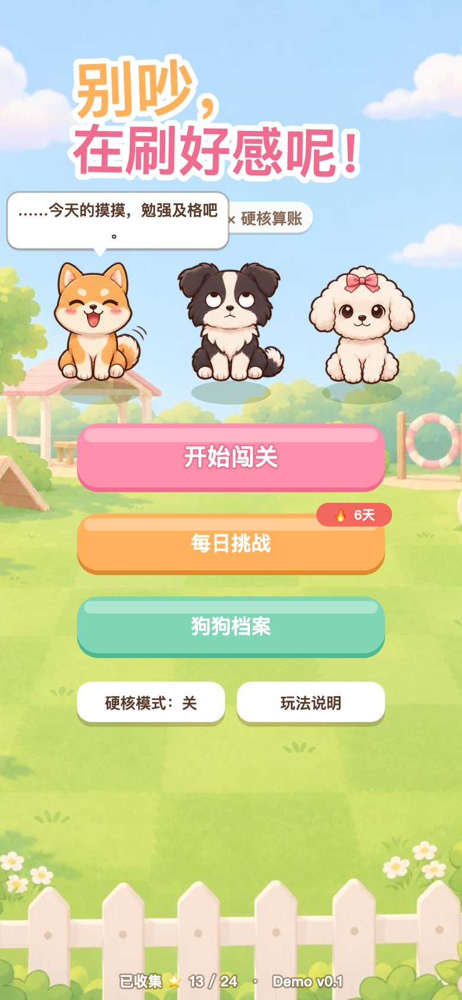
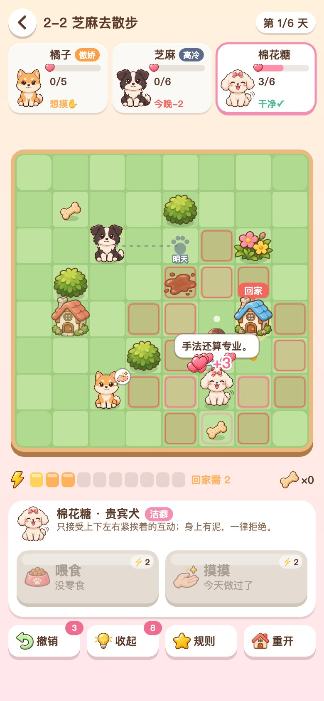
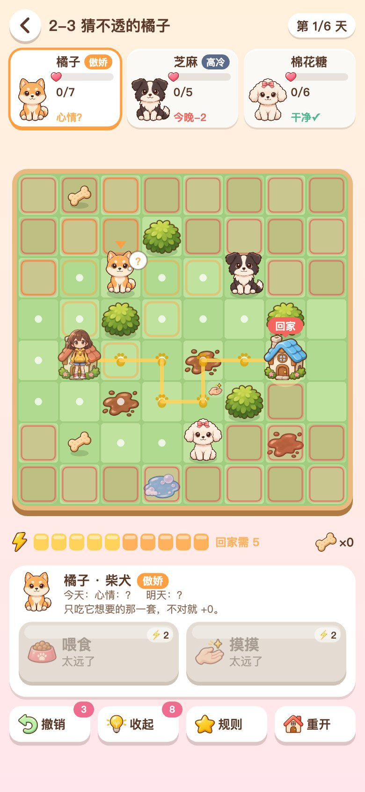
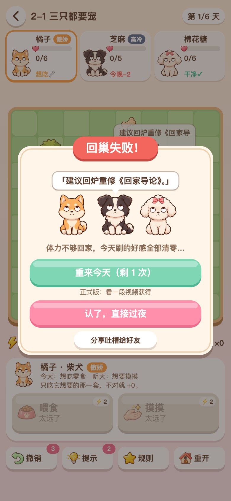
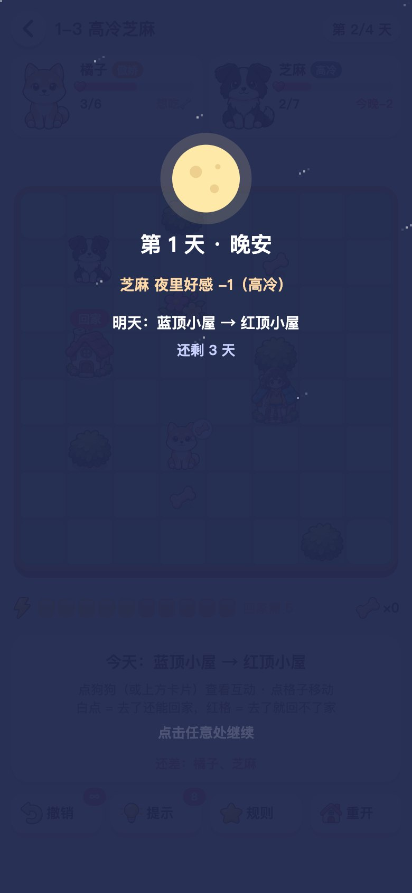
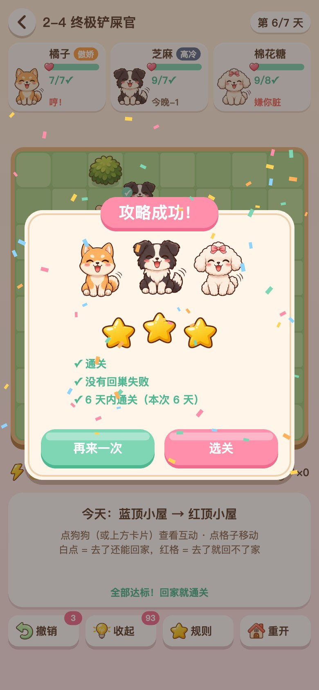
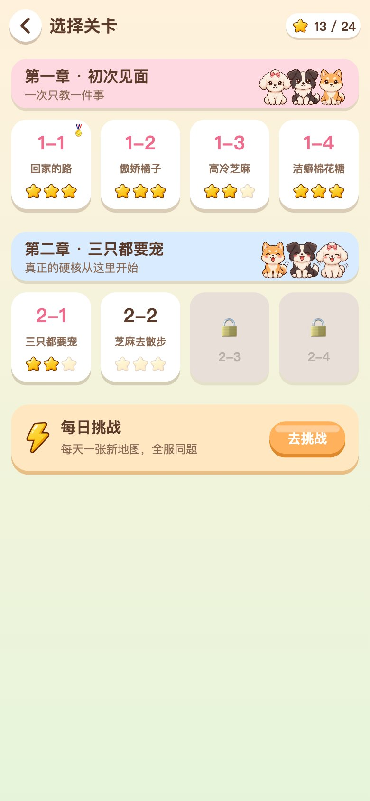
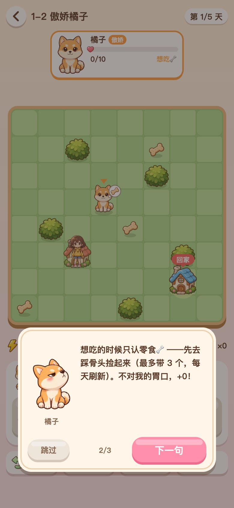
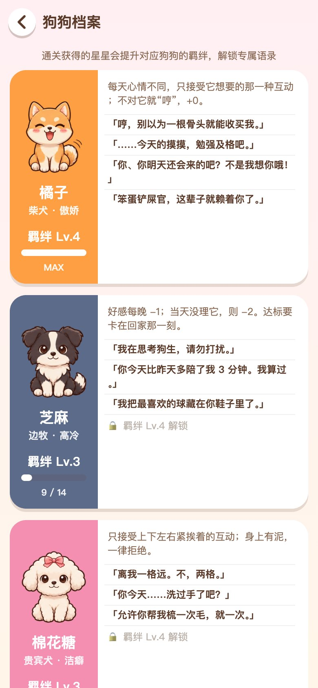

# 别吵，在刷好感呢！

> 软萌狗狗 × 硬核算账 —— 一款 8×8 走格策略 + 宠物养成的微信小游戏（Demo）

每天只有 10 点体力，走格子、喂零食、摸摸头，还必须在体力耗尽前回到**另一座**小屋。算错一步，三只狗狗集体翻白眼：“连家都回不去？”

## 💡 思路来源

本项目的创意来自公众号「思考千事万物」（作者：小波函数）的文章：

**[《别吵，在刷好感呢！｜ 一款把“铲屎官”逼疯的8×8硬核策略小游戏》](https://mp.weixin.qq.com/s/dlx8WqC6eNuw7Ac6FInsUg)**

在原文的核心设定（8×8 棋盘、每回合 10 点体力、回巢铁律、性格各异的狗狗）基础上，本项目补充了完整的数值规则、关卡设计、新手引导和留存系统，并做成了可以直接玩的 Demo。完整策划见 [docs/策划案.md](docs/策划案.md)。

## 📸 截图

<table>
  <tr>
    <td align="center"><br>主菜单</td>
    <td align="center"><br>走格子 · 刷好感</td>
    <td align="center"><br>最优路线提示</td>
  </tr>
  <tr>
    <td align="center"><br>回巢失败，集体翻白眼</td>
    <td align="center"><br>夜间结算</td>
    <td align="center"><br>三星通关</td>
  </tr>
  <tr>
    <td align="center"><br>选关与星级</td>
    <td align="center"><br>狗狗亲自教学</td>
    <td align="center"><br>狗狗档案 · 羁绊语录</td>
  </tr>
</table>

## 🎮 玩法

| 规则 | 说明 |
|---|---|
| ⚡ 体力 | 每天 10 点，当天用完就没有。走 1 格 -1，喂食 / 摸摸 -2 |
| 🏠 回巢铁律 | 每天从一座小屋出发，必须回到**另一座**小屋（红顶 ↔ 蓝顶每天交替） |
| 💥 回巢失败 | 剩余体力 < 回家距离的那一刻立即判负：当天好感全部清零，当天作废 |
| 🦴 零食 | 踩上去捡起，最多带 3 个，每天刷新；喂食要消耗 1 个 |
| 🔁 防刷 | 同一只狗每天喂食、摸摸各只能成功一次 |
| 🏆 通关 | 某天回到家的那一刻，所有狗狗好感都达标；★ 通关 ★ 零失败 ★ 标准天数内 |

### 三只狗狗

| | 橘子（柴犬） | 芝麻（边牧） | 棉花糖（贵宾犬） |
|---|---|---|---|
| 性格 | 傲娇 | 高冷 | 洁癖 |
| 互动范围 | 2 格内 | 2 格内 | 只认上下左右紧挨着 |
| 喂食 / 摸摸 | +4 / +3（必须对上心情） | +2 / +3 | +4 / +3 |
| 专属规则 | 每天心情：想吃 / 想摸 / 哼（全拒）；后期出现“？”心情，走近才揭晓 | 好感每晚 -1，当天没理它 -2 | 踩过泥坑就拒绝一切，踩水洼洗干净 |

## ✨ 在原文基础上补充的设计

- **双屋交替**：每天出发点和终点互换，同一张图每天路线都不一样
- **明牌可视化**：白点 = 去了还能回家，红格 = 去了就回不了家；体力条常驻“回家需要的体力”；互动按钮直接显示收益（`+4❤` / `+0 哼！`）
- **新手引导**：一关只教一个机制，由狗狗本狗用对话讲规则；走向死路需二次确认；撤销；提示会算出真正的最优路线
- **硬核模式**：关闭全部辅助，三星通关拿 🏅 勋章
- **棋盘元素**：灌木 / 栅栏 / 花坛、泥坑、水洼、零食，以及会“散步”的狗（提前显示明天的位置）
- **留存**：3 星评价、星星解锁章节、狗狗羁绊语录、每日挑战 + 连续打卡、失败吐槽分享卡

## 🚀 运行

### 微信开发者工具
1. 打开「微信开发者工具」→ 导入项目 → 选择本仓库目录
2. 项目类型选「小游戏」，AppID 可先用测试号（`project.config.json` 中为 `touristappid`）
3. 编译即可在模拟器中游玩，点「预览」扫码可在手机微信里试玩

`art_src/`、`docs/`、`tools/`、`index.html` 已在 `packOptions.ignore` 中排除，不会计入包体（约 2 MB）。

### 浏览器预览（开发调试）
```bash
python3 tools/serve.py 8765
```
打开 http://localhost:8765 ，桌面端会以手机竖屏比例显示。

### 关卡校验
打开 http://localhost:8765/tools/check.html ，内置求解器会算出每关的**理论最少天数**，并列出每天的最优走法。修改关卡后用它确认可解，并据此设置三星天数 `par`。

## 🗺️ 关卡

| 关卡 | 名称 | 新机制 | 标准天数 / 上限 |
|---|---|---|---|
| 1-1 | 回家的路 | 体力、回巢、摸摸 | 1 / 2 |
| 1-2 | 傲娇橘子 | 心情、零食、喂食 | 4 / 5 |
| 1-3 | 高冷芝麻 | 好感衰减、多狗分配 | 3 / 4 |
| 1-4 | 洁癖棉花糖 | 紧挨互动、泥坑、水洼 | 2 / 3 |
| 2-1 | 三只都要宠 | 三狗同场 | 5 / 6 |
| 2-2 | 芝麻去散步 | 散步路线 | 5 / 6 |
| 2-3 | 猜不透的橘子 | “？”心情 | 5 / 6 |
| 2-4 | 终极铲屎官 | 综合考验 | 6 / 7 |
| 每日 | 每日挑战 | 按日期生成，求解器校验可解 | 自动计算 |

标准天数均为求解器算出的理论最优解。第二章需第一章累计 5 颗星解锁。

## 📁 目录结构

```
game.js / game.json / project.config.json   微信小游戏入口与配置
index.html                                   浏览器预览入口
js/platform.js     平台适配层（微信 wx.* / 浏览器 DOM 一套代码）
js/engine.js       主循环、场景切换、即时模式按钮、绘图工具
js/rules.js        纯规则层 + 求解器（提示、关卡校验、每日挑战生成）
js/levels.js       关卡数据 + 每日挑战生成器
js/save.js         存档：星级、羁绊、打卡、设置
js/scenes/         menu / select / play / dogs 四个场景
images/            游戏素材（切好的精灵图）
art_src/           原始素材大图（不进包）
docs/              策划案与截图
tools/             本地预览服务器、关卡校验页
```

## 🔧 技术说明

- 纯 Canvas 2D 绘制，无第三方依赖，一套代码同时运行在微信小游戏和浏览器
- 规则层与渲染完全分离；求解器按天做广度搜索（枚举当天所有“回家结局” + 支配剪枝），单关求解在毫秒级
- 美术素材为 AI 绘图生成后切图，原图保存在 `art_src/`

## 📌 后续计划

- [ ] 音效与背景音乐
- [ ] 好友排行榜（微信开放数据域）
- [ ] 激励视频（重来今天 / 额外提示 / 额外撤销）
- [ ] 更多章节、季节活动关（雪地每步 1.5 体力、雨天全图泥坑）
- [ ] 狗狗装扮、相册与动态表情

## 📄 说明

游戏创意来自上文所列文章，归原作者所有；本仓库代码与素材仅供学习交流。
